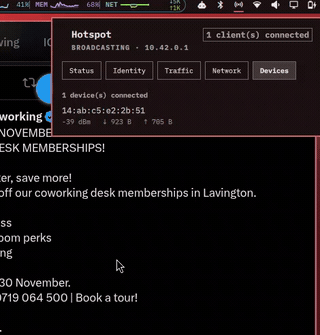
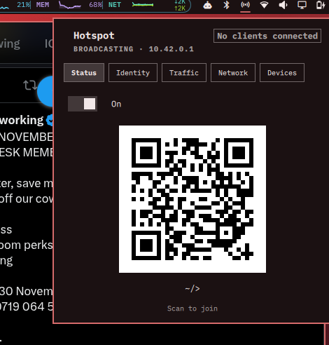
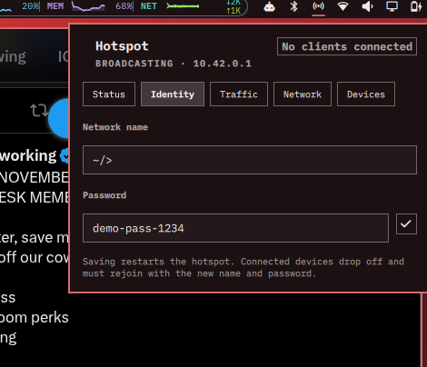
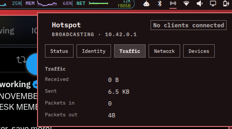
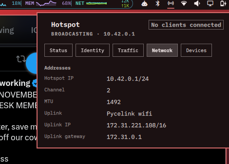
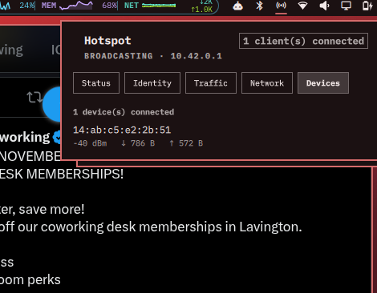

# Omarchy Hotspot

Turn your Omarchy laptop into a proper Wi-Fi hotspot — while staying connected to
the Wi-Fi it already uses — from the status bar, with a QR to share and a panel
to manage it.



Your machine stays a client of whatever Wi-Fi it is on (home, café, phone
hotspot) **and** broadcasts its own network at the same time. Guests get internet
through your machine via NAT, exactly the way Windows' "Mobile Hotspot" works.

---

## Why a hotspot on Omarchy?

Sometimes a mate just needs a quick boost. Instead of handing over your phone's
hotspot — and with it your data bundle, your carrier identity and a screen they
have to hold — you share a network that lives on a machine you control:

- **A quick boost, not a commitment.** Turn it on, they join by QR, turn it off.
  No phone settings changed, no bundle consumed on someone else's device.
- **Your personal internet stays personal.** Guests ride your uplink through NAT;
  they never touch your accounts, your browser sessions, or your phone.
- **You can see what is happening.** The panel shows live bytes/packets and every
  connected device with signal strength and per-device traffic. You can watch a
  transfer happen — and see who is using your bandwidth.
- **It is stable and it self-heals.** The hotspot re-arms itself after every
  reconnect and follows the uplink's channel automatically. Roam, sleep, resume —
  it comes back.
- **It is locked down by default.** No admin surface, no login prompt, guests
  isolated from each other. See [SECURITY.md](SECURITY.md).

---

## Features

| | |
|---|---|
| **Concurrent AP + STA** | One radio, two roles: your uplink keeps running while the hotspot broadcasts |
| **Bar widget** | Hotspot icon next to the network icon; bright when broadcasting |
| **Status tab** | On/off, SSID, scannable `WIFI:` QR |
| **Identity tab** | Rename the network and change the password — any printable characters, symbols welcome (`</>~&*!@#`) |
| **Traffic tab** | Bytes and packets in and out |
| **Network tab** | Hotspot address, channel, MTU, uplink SSID/IP/gateway |
| **Devices tab** | Each client: IP, signal, traffic |
| **Auto re-arm** | Reconnects are followed by the NetworkManager dispatcher |
| **Adaptive to the network** | Channel, path MTU and TTL handling are re-derived on every start |

| Status | Identity | Traffic | Network | Devices |
|---|---|---|---|---|
|  |  |  |  |  |

---

## Requirements

- Omarchy (quickshell shell) on Arch — the widget is a bar plugin.
- No extra hardware: a Wi-Fi card that advertises `AP` alongside `managed`
  (all current Intel/iwlwifi, most Atheros/MediaTek). Check with `iw list`.
- `hostapd`, `dnsmasq`, `qrencode` — `install.sh` installs them.
- A **2.4 GHz uplink**. One radio can only be on one channel (`#channels <= 1`),
  so the AP must mirror the uplink. On a 5 GHz uplink the installer refuses and
  your Wi-Fi is left untouched.

---

## Install

### Manual (human)

```bash
git clone https://github.com/kouragita/omarchy-hotspot.git
cd omarchy-hotspot
sudo ./install.sh          # or: pkexec ./install.sh
systemctl start omarchy-hotspot.service
```

Then click the hotspot icon in the bar. The QR is on the **Status** tab —
scan it from the guest device.

If you prefer to start it from the panel, just flip the toggle; the intent flag
is written for you and the hotspot will come back on its own after reconnects.

### Removing

```bash
sudo ./uninstall.sh            # keeps your SSID/password and the plugin
sudo ./uninstall.sh --purge    # removes those too
```

### Manual (agent)

Agents work in Omarchy differently from a normal shell. Follow this and nothing
will surprise you:

1. **Read before acting.** `README.md` and `SECURITY.md` in this repo, plus
   `~/.pi/agent/AGENTS.md` if present. Do not edit `/usr/share/omarchy/` — it is
   replaced on every `omarchy update`. User plugins live in
   `~/.config/omarchy/plugins/`.
2. **Escalate with `pkexec`, never by piping a password.** There is no TTY in an
   agent context, so `sudo` fails with *"a password is required"* and
   `sudo -S`/`-A` writes secrets into logs. Use `pkexec ./install.sh`; the human
   approves a dialog and the password never enters the transcript.
3. **Run the installer, do not hand-assemble it.** It is idempotent and prints
   exactly what it installed.
4. **Verify with evidence, in this order:**

   ```bash
   systemctl is-active omarchy-hotspot.service        # expect: active
   iw dev | grep -E 'Interface|type'                  # expect: wlp2s0 managed + ap0 AP
   ip -4 -o addr show dev ap0                         # expect: 10.42.0.1/24
   iw dev wlp2s0 link | grep SSID                     # uplink must still be associated
   ~/.local/share/omarchy-hotspot/hotspot-clients     # clients, if any
   ```

5. **Check the invariants that actually matter.** The uplink must never drop, and
   guests must never gain administrative reach:
   - `ip route show default` still points at the uplink gateway.
   - `ufw status | grep 'on ap0'` shows only DNS/DHCP — **no SSH unless the owner
     created `~/.config/omarchy-hotspot/allow-ssh`.**
   - `ap_isolate=1` is in `/run/hotspot-hostapd.conf`.
6. **If something fails,** read `journalctl -u omarchy-hotspot.service -n 50` —
   `apply.sh` prints its own stage numbers and rolls back on failure rather than
   leaving half a hotspot behind. Then run
   `~/.local/share/omarchy-hotspot/teardown.sh` and retry.

---

## How it works

```
        uplink (Wi-Fi client)                  hotspot (AP)
    ┌────────────────────────┐           ┌────────────────────────┐
    │ wlp2s0  managed        │           │ ap0     AP             │
    │ 172.31.x.x  ← DHCP     │           │ 10.42.0.1/24           │
    └───────────┬────────────┘           └───────────┬────────────┘
                │                                    │
                └──────────── one phy ───────────────┘
                             iwlwifi, same channel

    guest ──▶ ap0 ──▶ nft: TTL fix ──▶ ip_forward ──▶ masquerade ──▶ wlp2s0 ──▶ internet
```

The moving parts:

| File | Role |
|---|---|
| `runtime/apply.sh` | Creates the AP vif, starts hostapd + dnsmasq, installs NAT, verifies the uplink survived, rolls back on any failure |
| `runtime/teardown.sh` | Kills hostapd **before** deleting pidfiles, removes the vif and rules |
| `runtime/nat.nft` | NAT, MSS clamp, TTL restoration |
| `runtime/dnsmasq.conf` | DHCP + DNS for guests |
| `system/omarchy-hotspot.service` | oneshot unit: apply on start, teardown on stop |
| `system/90-omarchy-hotspot` | NM dispatcher: re-arm on reconnect, restart on channel change |
| `system/60-omarchy-hotspot.rules` | polkit: allow the local user to manage *only* this unit |
| `plugin/` | The bar widget and its panel |

The hotspot lives on a **second interface** (`ap0`) created on the same phy.
Your connection (`wlp2s0`) is only ever *read* by the scripts, never reconfigured.

### The two things that will bite anyone doing this

**1. Anti-tethering TTL clamping.** Some uplinks (mobile carriers, phone
hotspots) hand inbound packets a TTL of 1 so that a tethered machine cannot
forward them. Locally-delivered traffic still works — so DHCP, DNS and the
host's own browsing are fine, while every forwarded reply dies. The kernel's own
`ICMP time-exceeded` is the tell. `nat.nft` restores the TTL after de-NAT and
before the forward decrement.

**2. Path MTU smaller than 1500.** Typical PPPoE-style uplinks are 1492. Guests
are told 1500, build 1500-byte segments, and those are dropped silently — small
requests (browsing) work, downloads hang. `apply.sh` probes the real path MTU
each start, sets the AP MTU and DHCP option 26 to match, and clamps TCP MSS to
`MTU − 40`. PMTUD does not save guests, because the needed ICMP is addressed to
the NATed host.

Both of these look like "the hotspot is broken" and are neither.

---

## Configuration

`~/.config/omarchy-hotspot/config` (mode 600, single source of truth):

```text
SSID=omarchy-share
PASS=<generated 16 characters>
```

Edit it from the **Identity** tab, or by hand followed by:

```bash
systemctl restart omarchy-hotspot.service
```

Optional:

```bash
# expose SSH to hotspot clients (needed by runtime/phone-tunnel)
touch ~/.config/omarchy-hotspot/allow-ssh
# turn the hotspot off and stop the auto re-arm
rm -f ~/.local/state/hotspot/enabled
```

---

## Security

Short version: **a hotspot hands out internet, not a login prompt.**

- Guests reach DNS and DHCP on `10.42.0.1`. Nothing else.
- SSH is **off** unless you create the `allow-ssh` flag.
- `ap_isolate=1` — guests cannot reach each other.
- No admin surface: the polkit rule is scoped to one unit and requires an
  *active local session*, which a network client does not have.
- No `NOPASSWD` sudoers entries are installed.

Read [SECURITY.md](SECURITY.md) for the full threat model, including what a
guest can still do (consume bandwidth — there is deliberately no quota).

---

## Troubleshooting

| Symptom | Cause | Fix |
|---|---|---|
| Stuck at "Obtaining IP address" | DHCP rule matched `10.42.0.1`, but DISCOVER is broadcast to `255.255.255.255` | keep the rule address-free (`to any port 67`) |
| Connected, no internet; DNS works | inbound TTL clamped to 1 by the uplink | the `ttlfix` chain in `nat.nft` |
| Browsing works, downloads hang | path MTU < 1500 | MSS clamp + DHCP option 26 (automatic) |
| `nl80211: Match already configured` | an orphan hostapd still owns `ap0` | `teardown.sh` now kills by pattern before removing pidfiles |
| Won't start on 5 GHz | one radio, one channel | use a 2.4 GHz uplink or a USB adapter |
| Guests can't reach a local service | it is bound to `127.0.0.1` | use an SSH tunnel; do not rebind it |

Logs:

```bash
journalctl -u omarchy-hotspot.service -n 50 --no-pager
journalctl -u omarchy-hotspot.service -f            # while starting
```

---

## Repository layout

```
plugin/        bar widget + panel (installs into ~/.config/omarchy/plugins/)
runtime/       apply/teardown/helpers + hostapd, dnsmasq and nft templates
system/        systemd unit, NM dispatcher, NM conf, polkit rule
docs/          screenshots and the demo recording
install.sh     idempotent installer (root)
uninstall.sh   remover (--purge to drop config and plugin)
```

Installed paths:

```
~/.local/share/omarchy-hotspot/          runtime scripts + templates
~/.config/omarchy-hotspot/config         SSID + password (600)
~/.config/omarchy/plugins/kouragita.hotspot/   bar widget
~/.local/state/hotspot/enabled           intent flag
/etc/systemd/system/omarchy-hotspot.service
/etc/NetworkManager/dispatcher.d/90-omarchy-hotspot
/etc/NetworkManager/conf.d/99-ap0-unmanaged.conf
/etc/polkit-1/rules.d/60-omarchy-hotspot.rules
```

Nothing is written to `/usr/share/omarchy/`, so `omarchy update` cannot clobber
it. If you ever run `omarchy refresh shell`, re-run `install.sh` to put the
widget back on the bar.

---

## License

MIT — see [LICENSE](LICENSE).
